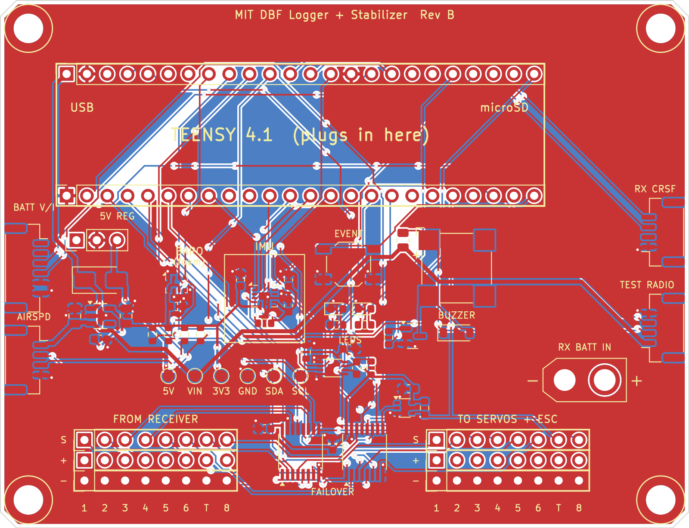

# MIT DBF Logger + Stabilizer board (Rev B)



Everything for the Teensy 4.1 board that stabilizes the plane, sends telemetry to the pilot's radio and logs every flight.
Status: **routed and order-ready (Rev B)**. Every connection is routed, the design check has no electrical errors, and the JLCPCB files are in [jlcpcb/](jlcpcb/). Two pin orders still need a check before you pay (see Open questions).

| File | What it is |
|---|---|
| [wiring/avionics-wiring.png](wiring/avionics-wiring.png) | **Full avionics wiring diagram**: both batteries, receiver, board, servos, ESC and motor (SVG next to it) |
| [design-spec.md](design-spec.md) | How the board works: failover, ESC telemetry, power, pins, bring-up order |
| [kicad/dbf-carrier.kicad_pro](kicad/dbf-carrier.kicad_pro) | KiCad project; open it in KiCad 7 or newer |
| [kicad/board-top.png](kicad/board-top.png) | Picture of the routed board (red = top copper, blue = bottom copper) |
| [kicad/board-inner-planes.png](kicad/board-inner-planes.png) | The two inner layers: ground plane and servo-power plane |
| [jlcpcb/ORDERING.md](jlcpcb/ORDERING.md) | How to order: Gerber zip, parts list (BOM) and placement file (CPL) for JLCPCB |
| [kicad/drc-report.txt](kicad/drc-report.txt) | Design check output: 0 shorts, 0 clearance errors, 0 unconnected pins |
| [pinout.csv](pinout.csv) | Which Teensy pin does what |
| [parts-list.xlsx](parts-list.xlsx) / [bom.csv](bom.csv) | Parts with links and prices; about $369 for one plane set + 2 built boards |
| [module-menu.md](module-menu.md) | Every module, and whether it is needed or optional |
| [rules-check-2027.md](rules-check-2027.md) | 2027 rules draft and last year's Q&A, checked against the board |

Online versions:
- Board slide deck: https://claude.ai/artifact/GLwo9eBtNZT7Tdii5Wy8GB

## Changes on 2026-11-07 (before ordering)

- **RX CRSF connector (J6) now matches the RadioMaster ER8's CRSF port** (⊖, +, RX, TX), so a standard pin-1-to-pin-1 JST-GH cable works. Pin 2 (the receiver's 5 V) is left unconnected on the board.
- **ESC is the Castle Phoenix Edge 100** (34 V, 100 A, 5 A BEC), not the Edge Lite. The **+ pin of the T column on TO SERVOS + ESC is now unconnected**, so the ESC's BEC can never feed the servo rail, even if its red wire is left in.
- Rerouted, design check rerun (0 unconnected pads, no new warnings), JLCPCB files regenerated. **Re-upload the Gerber zip, BOM and CPL to JLCPCB before paying, and set the part rotations again** (see [jlcpcb/ORDERING.md](jlcpcb/ORDERING.md)).

## Open questions

Before paying for the JLCPCB order:
1. Check the pin order printed on your Pololu S7V7F5 (the board assumes VIN, GND, VOUT).
2. Check the buzzer's + pad on the CMT-8504 drawing (the board uses the pad KiCad marks with +).

Not blocking the order:

3. Confirm in this year's Q&A that a custom microcontroller stabilization system is allowed. Ask about the optional inline current sensor too (the ESC's own telemetry avoids it).
4. Bench-test Castle Link Live with the board's 10k pull-up to 3.3 V (Castle's adapters use 10k to the receiver's +). If it doesn't work, R9 can be changed by hand.
5. **Battery voltage:** the Phoenix Edge 100 is rated 34 V max. A full 8S LiPo is 33.6 V, which is right at the limit. Consider 7S if the motor allows it.
6. Confirm how the 2 drop servos are wired (Y-cable on receiver channel 8).

Done:
- Receiver confirmed as a **RadioMaster ER8 2.4 GHz**. Its CRSF port order (⊖, +, RX, TX) was checked from a photo, and the board now matches it.

## ESC setup (Castle Phoenix Edge 100)

1. Pull the **red** wire out of the ESC's throttle plug (lift the tab with a needle) and shrink-wrap it. The board already ignores it, but this shows the BEC is disabled at tech inspection (rules 3.2.3).
2. With a Castle Link USB adapter, turn **Link Live on**, set **fixed throttle endpoints** (not auto-calibrate), and check the low-voltage cutoff matches your cell count.
3. Plug the throttle lead into **T** on TO SERVOS + ESC, with the signal wire on S.

## CRSF cable (ER8 to board)

Use a JST-GH 1.25 mm 4-pin cable wired **pin 1 to pin 1** (same direction), not a reversed one. Before plugging in the Teensy, power the receiver and check with a meter: 5 V should appear only on J6 pin 2.

## Regenerating the board

The board is generated by Python scripts that use KiCad's `pcbnew` module (KiCad 7). Run them in order from the `kicad/` folder:

```
python3 make_board.py     # places the parts
python3 route_board.py    # routes every connection
python3 finish_board.py   # planes, design check, JLCPCB files
```

The wiring diagram is drawn by `wiring/make_wiring.py`.
